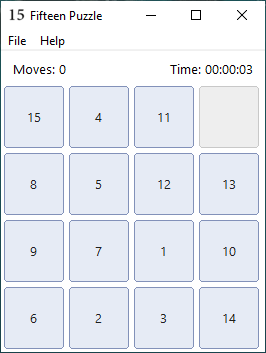

# Fifteen Puzzle for Windows

A small native Windows implementation of the classic 15-puzzle, written in C with the Win32 API. It is both a playable desktop game and a compact educational example of traditional Windows GUI programming without a framework or game engine.

## Features

- Solvable randomized 4×4 boards
- Move counter and elapsed-time display
- Undo and redo history
- Save, Save As, Load, and Load From
- Restart the same puzzle or start a new game
- Pause and resume
- Owner-drawn tile buttons
- Compact binary `.15` save format
- Keyboard shortcuts for common actions

## Download

Download the latest ready-to-run Win32 package from [GitHub Releases](https://github.com/delphi-coder/fifteen-puzzle-win/releases/latest).

## Build

Open [`fifteen-puzzle-win.sln`](fifteen-puzzle-win/fifteen-puzzle-win.sln) in Visual C++ 2010 and build the Win32 Debug or Release configuration. The project uses plain C, Win32 controls, resources, and the Windows common-dialog APIs.

The main source is [`fifteen-puzzle.c`](fifteen-puzzle-win/fifteen-puzzle.c). It contains the entry point, window procedure, puzzle logic, custom drawing, timer, save/load, and undo/redo implementation.

## Keyboard shortcuts

| Shortcut | Action |
| --- | --- |
| `Ctrl+S` | Save |
| `Ctrl+Shift+S` | Save As |
| `Ctrl+O` | Load |
| `Ctrl+Shift+O` | Load From |
| `Ctrl+Z` | Undo |
| `Ctrl+Y` | Redo |

## Project site

Visit [delphi-coder.github.io/fifteen-puzzle-win](https://delphi-coder.github.io/fifteen-puzzle-win/) for screenshots, technical notes, downloads, and an overview of the implementation.

## License

Released under the [MIT License](LICENSE).
